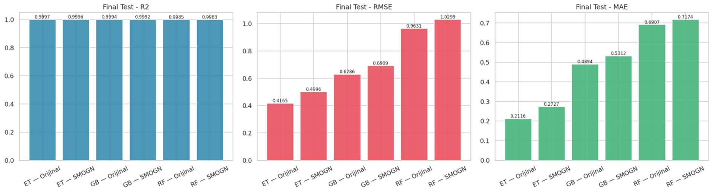
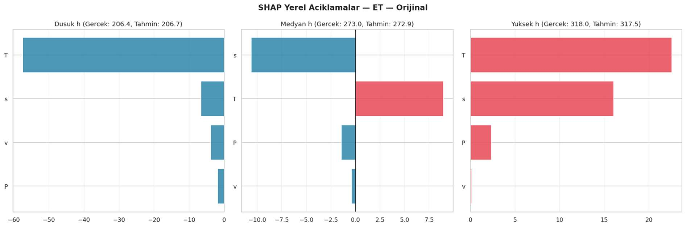
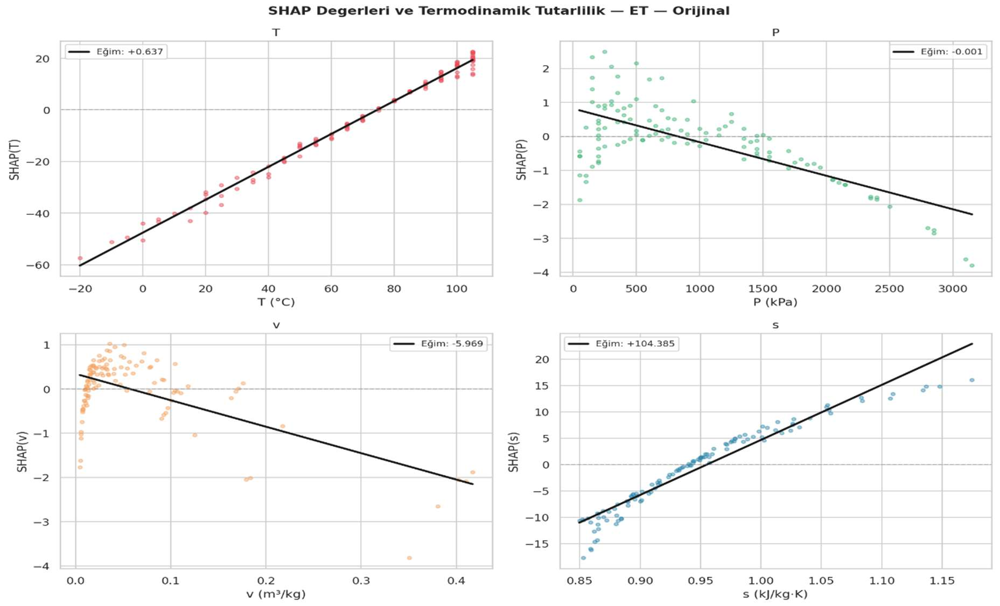

# R515B Enthalpy Prediction with Explainable Machine Learning

**English** | [Türkçe](README.tr.md)

Predicting the specific enthalpy of the R515B refrigerant in its **superheated-vapor region** using tree-based ensemble regressors, with a comparative analysis of **SMOGN data resampling**, **model explainability**, and **thermodynamic plausibility**.

The workflow uses **Gradient Boosting (GB)**, **Random Forest (RF)**, and **Extra Trees (ET)** models. It compares the original training data with SMOGN-resampled training data, then investigates the fitted models using feature importance, permutation importance, SHAP, and LIME.

> **Best model:** **Extra Trees (original data)** — **R² = 0.99972**, **RMSE = 0.41646 kJ/kg**, **MAE = 0.21163 kJ/kg**. The full comparison and SHAP visualizations are provided below.

## Contents

- [Project objectives](#project-objectives)
- [Dataset](#dataset)
- [Methodology](#methodology)
- [Experimental results](#experimental-results)
- [Explainability and physical interpretation](#explainability-and-physical-interpretation)
- [Repository structure](#repository-structure)
- [Installation and usage](#installation-and-usage)
- [Generated artifacts](#generated-artifacts)
- [Limitations and reproducibility](#limitations-and-reproducibility)

## Project objectives

The project investigates whether data-driven models can estimate superheated-vapor enthalpy accurately while remaining interpretable in engineering terms. In particular, it aims to:

1. Examine the structure and quality of the R515B property tables.
2. Predict enthalpy from **temperature, pressure, specific volume, and entropy**.
3. Compare GB, RF, and ET using a common, held-out test partition.
4. Evaluate whether SMOGN supports less densely represented enthalpy regions.
5. Interpret feature contributions at both global and individual-prediction levels.
6. Compare learned patterns with expected thermodynamic behavior, without treating explanatory plots as formal proofs of physical compliance.

## Dataset

Two supplied Excel workbooks describe R515B thermodynamic properties:

| Dataset | Observations | Features after preprocessing | Role |
|---|---:|---:|---|
| Superheated-vapor properties | 578 | 5 | Main regression dataset |
| Saturated-phase properties | 136 | 8 | Supporting exploratory analysis |

**Regression inputs and target**

| Symbol | Property | Unit | Role |
|---|---|---|---|
| `T` | Temperature | °C | Input |
| `P` | Pressure | kPa | Input |
| `v` | Specific volume | m³/kg | Input |
| `s` | Specific entropy | kJ/(kg·K) | Input |
| `h` | Specific enthalpy | kJ/kg | **Target** |

The original superheated-vapor workbook has **six raw columns**: `T`, `P`, `v`, `h`, `s`, and a constant `state` column. The last column is removed before modeling, leaving five columns. The saturated-property workbook contains eight properties. The original sheets contain an extra units row, so they are loaded with `pd.read_excel(..., skiprows=1)`.

Both datasets were checked for missing values and duplicate rows. IQR outlier detection was used for inspection, **not** to delete potentially valid extreme thermodynamic states. The supplied files passed the included input-data checks.

### Data availability

The downloadable local project package contains the two workbooks under `data/raw/` with simplified ASCII filenames. **They are intentionally excluded from Git by `.gitignore`**, pending verification of their redistribution terms. After cloning the GitHub repository, place both workbooks in `data/raw/`:

```text
data/raw/
├── R515B_kizgin_buhar.xlsx
└── R515B_doymus_ozellikleri.xlsx
```

Do not change the numerical values or the two-row header format. If you have differently named copies, rename the files only (not their contents). The program does not fetch the data automatically.

## Methodology

### 1. Data preprocessing and split

- Initial data checks, descriptive statistics, IQR outlier inspection, distribution plots, and correlations.
- A reproducible `random_state=42` random split of the 578 superheated-vapor records into approximately **60% training (346)**, **20% validation (116)**, and **20% test (116)**.
- `StandardScaler` fitted on the relevant training subset, then applied to the corresponding validation/test data.
- Training-only resampling: the independent test partition is **never** augmented with SMOGN samples.

### 2. Original-data model search

GB, RF, and ET are each evaluated with a grid of model parameters. Three-fold cross-validation metrics are recorded within the training subset; candidate comparisons and selections also use the separate validation set. The leading candidate of each model family is subsequently retrained using the combined training + validation portion and evaluated on the untouched test portion.

### 3. SMOGN-based resampling

Because some enthalpy intervals are more sparsely represented, SMOGN is evaluated as a controlled alternative to the original training distribution. Before resampling, `P` and `v` undergo a **log transformation** and numerical features are scaled; the transformations are reversed after generating candidate observations. Generated samples are filtered to plausible ranges defined from the training data and combined with the original training samples.

The final implementation explores **54 SMOGN configurations**:

- `k`: `3`, `5`, `7`
- `rel_thres`: `0.70`, `0.80`, `0.90`
- `pert`: `0.001`, `0.005`, `0.010`
- `under_samp`: `False`, `True`

A Gradient Boosting proxy evaluates these resampling candidates on validation data. Selected SMOGN configurations are then evaluated with the three model families. The final comparison uses identical held-out test data for original and SMOGN scenarios.

### 4. Evaluation

The original code calculates **R², RMSE, MAE, Tail-MAE, residual mean and standard deviation, maximum absolute error**, and the percentages of predictions with absolute error ≤1 and ≤2 kJ/kg. Here, **Tail-MAE** is the MAE of test observations at or below the target's 15th percentile or at or above its 85th percentile, as implemented in the code.

A secondary composite metric is defined in the source as:

`General Score = R² − 0.10 × RMSE − 0.05 × MAE`

This composite score is descriptive and specific to this experiment; it should not be treated as a standardized benchmark.

## Experimental results

### Independent test-set performance

The following table compares the six trained model configurations on the same held-out test set:

| Model | Training scenario | R² ↑ | RMSE ↓ (kJ/kg) | MAE ↓ (kJ/kg) | Tail-MAE ↓ (kJ/kg) |
|---|---|---:|---:|---:|---:|
| **Extra Trees** | **Original** | **0.99972** | **0.41646** | **0.21163** | **0.31895** |
| Extra Trees | SMOGN | 0.99960 | 0.49958 | 0.27265 | 0.45159 |
| Gradient Boosting | Original | 0.99937 | 0.62859 | 0.48945 | 0.50016 |
| Gradient Boosting | SMOGN | 0.99924 | 0.69091 | 0.53117 | 0.59751 |
| Random Forest | Original | 0.99852 | 0.96308 | 0.69070 | 0.78853 |
| Random Forest | SMOGN | 0.99830 | 1.02988 | 0.71740 | 0.76446 |

**Main finding:** Extra Trees trained on the original data produced the highest test R² and lowest test RMSE/MAE. SMOGN maintained high predictive accuracy but did **not** outperform the original-data scenario on the overall test metrics in this experiment. For RF, the Tail-MAE comparison is an exception to the general overall-error pattern: RF–SMOGN has a slightly lower Tail-MAE than RF–Original.



*Comparison of R², RMSE, and MAE for the six model configurations.*

## Explainability and physical interpretation

Global interpretability is investigated through **built-in feature importance, permutation importance, and mean absolute SHAP values**. Local explanations for selected low-, median-, and high-enthalpy test observations are generated using **SHAP and LIME**. LIME feature contributions are printed to the terminal in the preserved source workflow.

The feature-attribution analyses identify **temperature (`T`)** as the dominant signal, with **entropy (`s`)** also contributing strongly. For the leading original Extra Trees model, the SHAP dependence trend for temperature and entropy was positive, while pressure had a small negative trend. **Specific volume (`v`) showed a negative SHAP slope for Extra Trees**, illustrating that high predictive accuracy alone does not guarantee that every explanatory trend matches a simple physical expectation.





*Local SHAP contributions for low-, median-, and high-enthalpy observations (top), and feature-wise SHAP dependence trends (bottom). These explanations are not formal thermodynamic constraint tests.*

## Repository structure

```text
r515b-enthalpy-prediction-xai/
├── src/r515b/
│   ├── __init__.py
│   ├── config.py          # Paths, seed, and parameter grids
│   ├── data.py            # Data loading, validation, preprocessing, splitting
│   ├── modeling.py        # Estimators, metrics, model selection, evaluation
│   ├── resampling.py      # SMOGN generation and filtering
│   ├── explainability.py  # SHAP/LIME and thermodynamic trends
│   └── visualization.py   # Figures and Excel result exports
├── data/raw/              # Excel inputs; excluded from Git
├── docs/figures/          # Performance and SHAP results
├── outputs/               # Generated outputs; excluded from Git
├── tests/                 # Fast automated checks
├── main.py                # Project entry point
├── pyproject.toml
├── requirements.txt
├── .gitignore
├── README.md              # English
└── README.tr.md           # Türkçe
```


## Installation and usage

**Requirements:** Python 3.10–3.12 (3.11 or 3.12 recommended), sufficient RAM/CPU for parameter searches, and the two original Excel files. A GPU is not required for the scikit-learn tree models.

From the **project root** in PyCharm's Terminal or a regular terminal:

```powershell
# Windows / PowerShell
py -3.12 -m venv .venv
.venv\Scripts\Activate.ps1
python -m pip install -e .

# Confirm that both Excel files are in data/raw/
python main.py --check-data

# Run the complete original experiment (may be computationally intensive)
python main.py

# Run the safe data-validation smoke tests
python -m unittest discover -s tests -v
```

On macOS/Linux, create the environment with `python3 -m venv .venv` and activate with `source .venv/bin/activate`.


## Generated artifacts

The experiment writes its outputs to `outputs/` and produces, among others:

- `R515B_final_smogn_guclu_raporlar.xlsx`, with sheets for model performance, global XAI, physical-direction assessments, SMOGN candidates, residual details, and IQR summaries.
- Dataset distribution plots and relationships between features and enthalpy.
- Original vs. SMOGN comparisons and final performance figures.
- SHAP global and local diagrams, dependence plots, and residual/prediction figures.

`outputs/` is ignored by Git so that running the experiment will not accidentally commit large or machine-specific generated files. The model comparison and SHAP figures in `docs/figures/` are included in the repository so that the numerical results and model behavior can be examined without rerunning the full experiment.

## Limitations and reproducibility

- The model was assessed on a **random held-out split of the provided property table**; no extrapolation to unseen thermodynamic ranges or other refrigerants has been established.
- Synthetic SMOGN samples may not satisfy every thermodynamic relationship. The source filters numerical ranges but does not enforce complete physical constraints.
- SHAP feature attribution and fitted slopes are interpretive diagnostics, **not a guarantee of physical law compliance**.
- The complete source experiment has **not** been rerun in the converted environment; dependency versions and randomness may affect independently reproduced results.
- The source workbooks are excluded from the public repository pending data/license checks. The local ZIP contains them for running the experiment.


---

**Maintainer:** [Hatice Yaren Demir](https://github.com/yarendmr)
