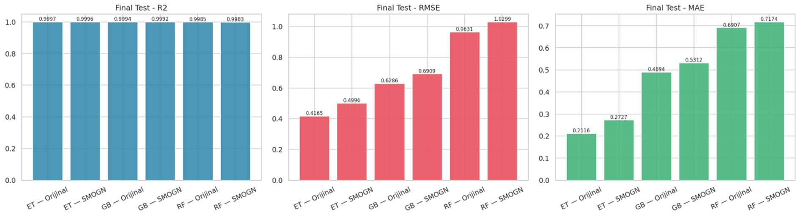
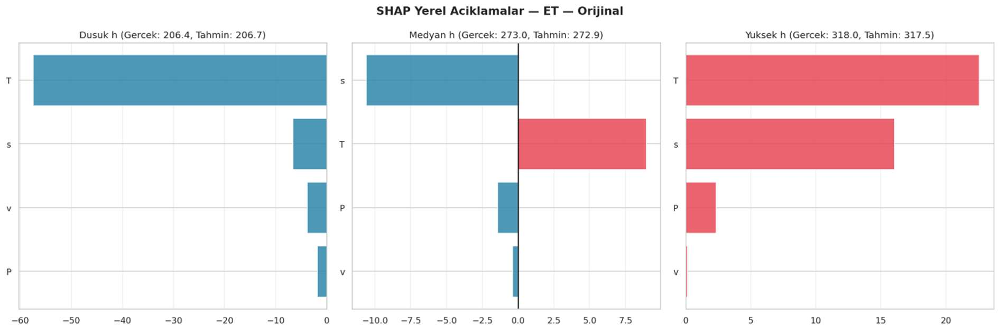
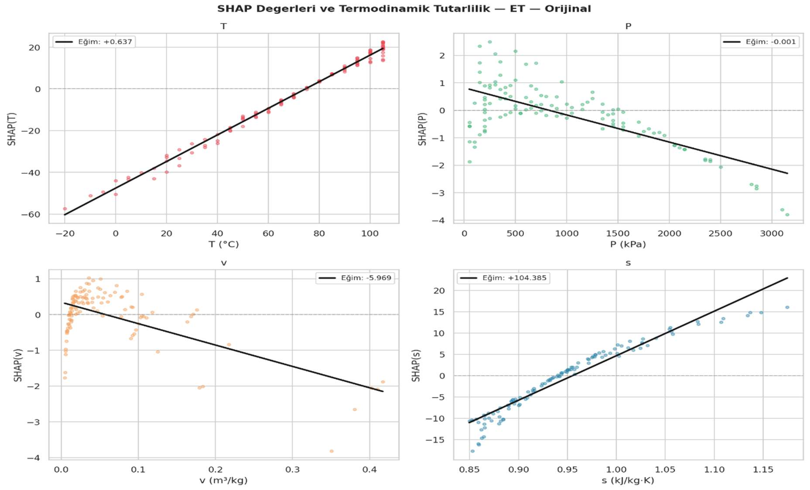

# R515B Entalpi Tahmini: Açıklanabilir Makine Öğrenmesi

[English](README.md) | **Türkçe**

Bu proje, R515B soğutucu akışkanının **kızgın buhar bölgesindeki özgül entalpi değerini** ağaç tabanlı makine öğrenmesi modelleriyle tahmin etmeyi; **SMOGN ile veri yeniden örneklemenin** etkisini, **model açıklanabilirliğini** ve **termodinamik açıdan anlamlılığı** birlikte incelemeyi amaçlar.

Çalışmada **Gradient Boosting (GB)**, **Random Forest (RF)** ve **Extra Trees (ET)** modelleri kullanılır. Modeller hem orijinal eğitim verisi hem de SMOGN ile yeniden örneklenmiş eğitim verisi üzerinde değerlendirilir. Model kararları feature importance, permutation importance, SHAP ve LIME analizleriyle incelenir.

> **En başarılı model:** **Extra Trees (orijinal veri)** — **R² = 0.99972**, **RMSE = 0.41646 kJ/kg**, **MAE = 0.21163 kJ/kg**. Altı modelin karşılaştırması ve SHAP görselleri aşağıda yer almaktadır.

## İçindekiler

- [Projenin amacı](#projenin-amacı)
- [Veri seti](#veri-seti)
- [Yöntem](#yöntem)
- [Deney sonuçları](#deney-sonuçları)
- [Açıklanabilirlik ve fiziksel yorum](#açıklanabilirlik-ve-fiziksel-yorum)
- [Proje yapısı](#proje-yapısı)
- [Kurulum ve çalıştırma](#kurulum-ve-çalıştırma)
- [Üretilen çıktılar](#üretilen-çıktılar)
- [Sınırlılıklar ve yeniden üretilebilirlik](#sınırlılıklar-ve-yeniden-üretilebilirlik)

## Projenin amacı

Projenin temel hedefi, kızgın buhar entalpisini yüksek doğrulukla tahmin ederken modellerin mühendislik açısından yorumlanabilir davranış gösterip göstermediğini araştırmaktır. Bu doğrultuda:

1. R515B termodinamik veri tablolarının yapısı ve veri kalitesi incelenir.
2. **Sıcaklık, basınç, özgül hacim ve entropi** değişkenleriyle entalpi tahmini yapılır.
3. GB, RF ve ET modelleri aynı bağımsız test kümesi üzerinde karşılaştırılır.
4. Seyrek temsil edilen entalpi aralıklarını desteklemek için SMOGN yaklaşımı değerlendirilir.
5. Küresel ve yerel açıklanabilirlik yöntemleriyle model kararları yorumlanır.
6. Model eğilimleri termodinamik beklentilerle karşılaştırılır; açıklama grafikleri fiziksel yasaların kesin kanıtı olarak değerlendirilmez.

## Veri seti

Çalışmada R515B akışkanına ait iki Excel veri tablosu kullanılmıştır:

| Veri seti | Gözlem sayısı | Ön işleme sonrası sütun | Kullanım |
|---|---:|---:|---|
| Kızgın buhar özellikleri | 578 | 5 | Entalpi tahmininde ana veri |
| Doymuş faz özellikleri | 136 | 8 | Destekleyici keşifsel analiz |

**Girdi ve hedef değişkenleri**

| Sembol | Değişken | Birim | Rol |
|---|---|---|---|
| `T` | Sıcaklık | °C | Girdi |
| `P` | Basınç | kPa | Girdi |
| `v` | Özgül hacim | m³/kg | Girdi |
| `s` | Özgül entropi | kJ/(kg·K) | Girdi |
| `h` | Özgül entalpi | kJ/kg | **Hedef** |

Kızgın buhar Excel dosyasında başlangıçta **altı sütun** (`T`, `P`, `v`, `h`, `s`, `state`) bulunmaktadır. Bütün kayıtlarda aynı bilgiyi içeren `state` sütunu kaldırılır ve modelleme beş sütunla sürdürülür. Doymuş özellikler dosyasında sekiz özellik vardır. Kaynak dosyaların ikinci satırında birimler bulunduğu için yükleme aşamasında `pd.read_excel(..., skiprows=1)` uygulanır.

Eksik değer ve tekrar eden satır kontrolleri yapılmış; IQR yöntemiyle aykırı görünen değerler incelenmiştir. **Fiziksel açıdan geçerli olabilecek uç gözlemler sırf istatistiksel sınırların dışında kaldıkları için silinmemiştir.** Gönderilen veri dosyaları, paketteki veri doğrulama kontrollerinden geçmiştir.

### Veri dosyalarının konumu

İndirilebilir ZIP dosyasındaki `data/raw/` klasöründe iki Excel dosyası bulunur. **Veri kullanım/yeniden dağıtım koşulları henüz doğrulanmadığından Excel dosyaları `.gitignore` ile GitHub paylaşımından çıkarılmıştır.** GitHub'dan klonlanan bir kopyada aşağıdaki dosyalar elle yerleştirilmelidir:

```text
data/raw/
├── R515B_kizgin_buhar.xlsx
└── R515B_doymus_ozellikleri.xlsx
```

Dosyaların yalnızca adları sadeleştirilmiştir; sayısal içerikleri değiştirilmemiştir. Başlık/birim satırları orijinal hâliyle korunmalıdır. Program veri dosyalarını internetten otomatik indirmez.

## Yöntem

### 1. Veri ön işleme ve bölme

- Eksik/tekrar kayıt kontrolü, temel istatistikler, IQR analizi, dağılım grafikleri ve korelasyon incelemeleri.
- `random_state=42` ile 578 kızgın buhar gözleminin yaklaşık **%60 eğitim (346)**, **%20 doğrulama (116)** ve **%20 test (116)** olarak ayrılması.
- `StandardScaler` dönüşümünün ilgili eğitim kümesinde öğrenilmesi, doğrulama ve test verilerine aynı dönüşümün uygulanması.
- SMOGN'un yalnızca eğitim verisi üzerinde uygulanması; bağımsız test kümesinin sentetik örneklerle değiştirilmemesi.

### 2. Orijinal veri ile model araması

GB, RF ve ET için hiperparametre kombinasyonları taranır. Eğitim kümesinde üç katlı çapraz doğrulama ölçütleri hesaplanır; model adayları ayrı doğrulama kümesiyle de karşılaştırılır ve seçimde doğrulama başarısı kullanılır. Seçilen her model, eğitim ve doğrulama kümelerinin birleşimi üzerinde yeniden eğitilerek daha önce kullanılmamış test verisinde değerlendirilir.

### 3. SMOGN ile yeniden örnekleme

Entalpi dağılımının bazı bölgeleri daha az örnek içerdiğinden, SMOGN alternatif bir eğitim dağılımı oluşturmak için kullanılır. İşlem öncesinde `P` ve `v` değişkenleri **logaritmik dönüşümden** geçirilir; sayısal girdiler ölçeklenir. Sentetik örnekler oluşturulduktan sonra ters dönüşüm uygulanır, eğitim verisinden türetilen sınırlar dışında kalan adaylar elenir ve kalanlar orijinal eğitim örnekleriyle birleştirilir.

Final kodunda **54 SMOGN parametre kombinasyonu** değerlendirilir:

- `k`: `3`, `5`, `7`
- `rel_thres`: `0.70`, `0.80`, `0.90`
- `pert`: `0.001`, `0.005`, `0.010`
- `under_samp`: `False`, `True`

Önce bir Gradient Boosting modeliyle SMOGN adayları doğrulama kümesinde karşılaştırılır. Seçilen adaylar üç model ailesiyle test edilir. Orijinal ve SMOGN senaryolarının nihai karşılaştırmasında aynı bağımsız test kümesi kullanılır.

### 4. Değerlendirme ölçütleri

Kodda **R², RMSE, MAE, Tail-MAE, artık hata ortalaması ve standart sapması, maksimum mutlak hata**, ayrıca mutlak hatanın 1 ve 2 kJ/kg sınırları içinde kaldığı gözlem yüzdeleri hesaplanır. **Tail-MAE**, gerçek entalpi değerleri %15'lik alt veya %15'lik üst dilimde kalan test gözlemlerindeki MAE değeridir (kodda %15 ve %85 kuantilleri kullanılır).

Kodda ayrıca şu bileşik ölçüt vardır:

`Genel Skor = R² − 0.10 × RMSE − 0.05 × MAE`

Bu skor çalışmaya özgü yardımcı bir karşılaştırma ölçütüdür; standartlaştırılmış bir referans metriği değildir.

## Deney sonuçları

### Bağımsız test kümesi performansı

Altı model yapılandırmasının aynı bağımsız test kümesi üzerindeki sonuçları aşağıda karşılaştırılmıştır:

| Model | Eğitim senaryosu | R² ↑ | RMSE ↓ (kJ/kg) | MAE ↓ (kJ/kg) | Tail-MAE ↓ (kJ/kg) |
|---|---|---:|---:|---:|---:|
| **Extra Trees** | **Orijinal** | **0.99972** | **0.41646** | **0.21163** | **0.31895** |
| Extra Trees | SMOGN | 0.99960 | 0.49958 | 0.27265 | 0.45159 |
| Gradient Boosting | Orijinal | 0.99937 | 0.62859 | 0.48945 | 0.50016 |
| Gradient Boosting | SMOGN | 0.99924 | 0.69091 | 0.53117 | 0.59751 |
| Random Forest | Orijinal | 0.99852 | 0.96308 | 0.69070 | 0.78853 |
| Random Forest | SMOGN | 0.99830 | 1.02988 | 0.71740 | 0.76446 |

**Temel bulgu:** Orijinal veriyle eğitilen Extra Trees modeli en yüksek R² ve en düşük RMSE/MAE değerlerini elde etmiştir. SMOGN modelleri yüksek tahmin başarısını korumuş olsa da bu çalışmada genel test ölçütleri bakımından orijinal veri senaryosunu aşmamıştır. Bununla birlikte RF–SMOGN modelinin Tail-MAE değeri, RF–Orijinal modelinden bir miktar daha düşüktür; bu ayrıntı genel hata eğilimiyle karıştırılmamalıdır.



*Altı model yapılandırmasının R², RMSE ve MAE değerlerinin karşılaştırması.*

## Açıklanabilirlik ve fiziksel yorum

Küresel açıklanabilirlik kapsamında **klasik feature importance, permutation importance ve ortalama mutlak SHAP değerleri** incelenir. Yerel açıklamalarda test kümesinden düşük, ortanca ve yüksek entalpi örnekleri seçilerek **SHAP ve LIME** analizleri yapılır. Mevcut kodda LIME katkıları terminale yazdırılır.

Özellik katkısı analizlerinde **sıcaklık (`T`)** en baskın değişkendir; **entropi (`s`)** de güçlü katkı sunar. En başarılı Extra Trees – Orijinal modelinde sıcaklık ve entropi için pozitif SHAP eğilimleri, basınç için düşük büyüklükte negatif bir eğilim gözlenmiştir. Ancak **özgül hacim (`v`) için Extra Trees modelinin SHAP eğimi negatiftir**. Bu durum, çok yüksek tahmin başarısının tüm değişkenlerde basit fiziksel beklentilerle aynı işareti garanti etmediğini gösterir.





*Üstte düşük, ortanca ve yüksek entalpi örnekleri için yerel SHAP katkıları; altta değişkenlere göre SHAP bağlılık eğilimleri yer alır. Bu analizler fizik yasalarına kesin uygunluğun ispatı değildir.*

## Proje yapısı

```text
r515b-enthalpy-prediction-xai/
├── src/r515b/
│   ├── __init__.py
│   ├── config.py          # Yollar, tohum ve parametre aralıkları
│   ├── data.py            # Veri okuma, doğrulama, ön işleme, bölme
│   ├── modeling.py        # Modeller, metrikler, seçim ve değerlendirme
│   ├── resampling.py      # SMOGN üretimi ve filtreleme
│   ├── explainability.py  # SHAP/LIME ve termodinamik eğilimler
│   └── visualization.py   # Grafikler ve Excel çıktısı
├── data/raw/              # Excel girdileri; Git dışında
├── docs/figures/          # Performans ve SHAP görselleri
├── outputs/               # Üretilen çıktılar; Git dışında
├── tests/                 # Hızlı otomatik testler
├── main.py                # Programı başlatır
├── pyproject.toml
├── requirements.txt
├── .gitignore
├── README.md              # İngilizce
└── README.tr.md           # Türkçe
```


## Kurulum ve çalıştırma

**Gereksinimler:** Python 3.10–3.12 (tercihen 3.11 veya 3.12), parametre taramaları için yeterli RAM/CPU ve iki orijinal Excel dosyası. Scikit-learn ağaç modelleri için ekran kartı zorunlu değildir.

PyCharm Terminal'inde veya başka bir terminalde **proje ana klasöründeyken**:

```powershell
# Windows / PowerShell
py -3.12 -m venv .venv
.venv\Scripts\Activate.ps1
python -m pip install -e .

# Excel dosyalarını data/raw/ içine yerleştirdikten sonra
python main.py --check-data

# Tüm final analizini çalıştırmak için (hesaplama yükü yüksek olabilir)
python main.py

# Veri kontrolü testleri
python -m unittest discover -s tests -v
```

macOS/Linux için `python3 -m venv .venv` ve `source .venv/bin/activate` kullanılır.


## Üretilen çıktılar

Kod çalıştığında `outputs/` klasörüne aşağıdaki çıktılar kaydedilir:

- `R515B_final_smogn_guclu_raporlar.xlsx`: model performansları, küresel XAI, fiziksel tutarlılık değerlendirmeleri, SMOGN adayları, artık hata detayları ve IQR özetleri için farklı çalışma sayfaları.
- Veri dağılımları, korelasyonlar ve girdi–entalpi ilişkilerini gösteren grafikler.
- Orijinal/SMOGN veri karşılaştırmaları ve model performansı grafikleri.
- Küresel ve yerel SHAP grafikleri, bağlılık grafikleri, gerçek–tahmin ve artık hata görselleri.

`outputs/` klasörü `.gitignore` içinde olduğundan çalıştırma sonucu oluşan dosyalar otomatik olarak GitHub'a eklenmez. `docs/figures/` içindeki performans ve SHAP görselleri, sonuçların kodu yeniden çalıştırmadan incelenebilmesi için repoda tutulur.

## Sınırlılıklar ve yeniden üretilebilirlik

- Değerlendirme, eldeki termodinamik tablodan **rastgele ayrılmış test verisi** üzerinde yapılmıştır. Görülmemiş sıcaklık/basınç aralıklarına ekstrapolasyon veya başka akışkanlara genelleme başarısı gösterilmiş değildir.
- SMOGN ile üretilen gözlemler sayısal aralıklara göre filtrelenir; bütün termodinamik ilişkilerin sağlandığı ayrıca zorunlu kılınmaz.
- SHAP eğimleri ve özellik katkıları yorumlama araçlarıdır; **termodinamik yasaların eksiksiz sağlandığının kanıtı değildir**.
- Düzenlenen paket üzerinde bütün model araması ve XAI işlemleri **yeniden çalıştırılmamıştır**. Yeni çalıştırmada kütüphane sürümlerine ve rastgeleliğe bağlı farklar oluşabilir.
- Excel veri dosyaları, paylaşım koşulları netleşene kadar GitHub'a yüklenmez; yerel ZIP paketinde çalıştırmak için bulunurlar.


---

**Geliştirici:** [Hatice Yaren Demir](https://github.com/yarendmr)
